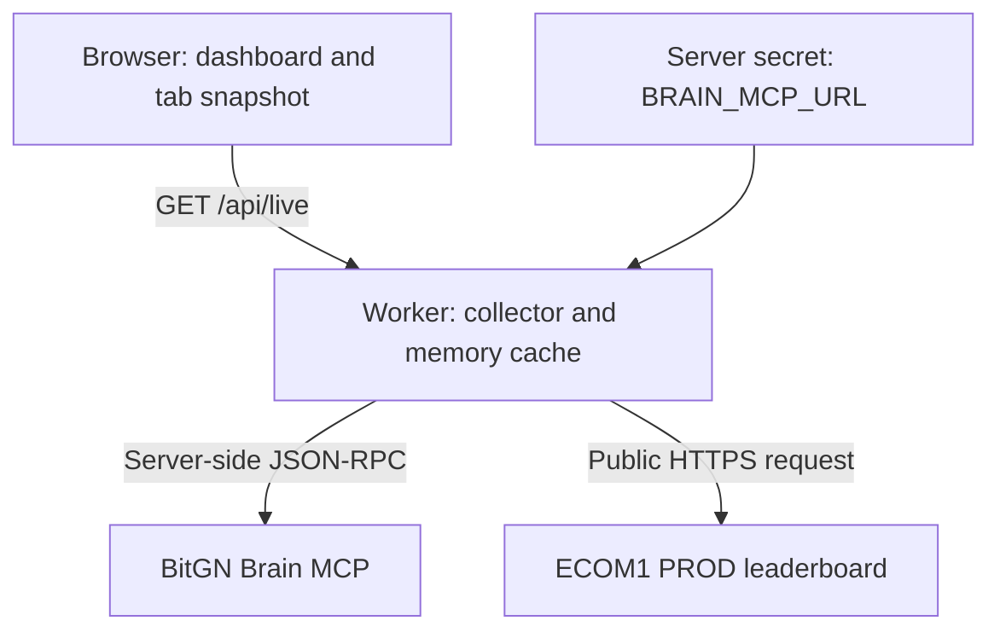

# Brain Live

**Queue, progress, and results for the shared BitGN Brain lab in one dashboard.**

Brain Live is an independent monitoring companion for [BitGN Brain](https://brain.bitgn.com/). It brings the active evaluation queue, running-job progress, recent outcomes, the lab baseline, and Brain-named entries from the public ECOM1 PROD leaderboard into a single view.

The idea is to make everyday participant questions easy to answer: *Has my run started? What is ahead of it? Did it finish successfully? What is my latest result, and which full evaluation is my best in the available history?*

**Current status:** a private, single-owner implementation configured for `romius` in workspace `w1`. It is not yet a general multiuser service. The interface is currently in Russian and displays times in `Europe/Berlin`. See [review.md](review.md) for the security assessment, participant rollout proposal, and prioritized changes.

## What it shows

| View | What you can learn | Scope |
| --- | --- | --- |
| Lab baseline | The working record recorded in `agent/BASELINE.md` | A workspace document, not a newly calculated official ranking |
| Active queue | Waiting jobs, running jobs, personal queue positions, and trial counts | Original queue positions are preserved when filtered |
| Running jobs | Progress and failures for simultaneous running/cancelling jobs | Unknown upstream values may remain unavailable |
| Best run | Highest scored completed personal full100 with at least 100 processed trials | Best in loaded Brain history, not a guaranteed all-time best |
| Latest run | Personal submission with the latest creation time | Includes queued, short, diagnostic, running, and completed jobs |
| Recent history | Outcome, type, score, processed count, failures, and links | Bounded history with additional personal records, described below |
| Brain ranking | Public PROD rows whose names start with `Brain ` | Best evaluated run per account; membership is inferred from the prefix |
| Full-run duration | Median elapsed duration of completed 100-trial jobs in loaded history | An operational indicator, not a scheduling promise |

The collector observes challenge work. It does not edit documents, submit trials, cancel jobs, or run an LLM to produce dashboard content. It does create a Brain read session and execute a fixed collector through MCP.

## How to use the dashboard

1. Open your authorized private deployment and wait for the first snapshot. Check the source timestamp and Live/stale indicator.
2. Use **Queue** to see waiting and active work. The top section lists each running or cancelling job separately.
3. Use the personal best and latest cards to distinguish the best completed full evaluation from the most recently submitted experiment.
4. Switch to **Brain ranking** for the filtered public leaderboard, or **History** for recent operational outcomes.
5. Search by run name, author/account, or job identifier as supported by the active view. The personal filter currently refers to `romius`.
6. Follow a job's link to its Brain document. An additional BitGN run link is shown for recognized personal jobs with a `run-…` identifier; access is still controlled by BitGN.
7. Use **Refresh** when needed. Automatic refresh runs every 60 seconds while the tab is visible, and when it becomes visible again.

These are English descriptions of controls in the current Russian interface.

**Known ownership limitation:** the public ranking's personal filter matches `romius` in the run title. A different participant crediting `romius` can therefore be included. Queue/history ownership use exact Brain author identity. Treat ranking highlighting as a name-based convenience until stable account mapping is implemented.

### Where is my run?

Queue/history and the public leaderboard answer different questions. A queued/running attempt will not appear as a newly evaluated leaderboard result. The public board selects one best evaluated run per account; a later lower result need not replace it. The dashboard then applies the `Brain ` name-prefix filter, so a valid account result can be absent. Older history may also be outside the collector's window. Check the official Brain source and your BitGN run page when views differ. [Platform explanation](https://bitgn.com/start/ecom)

## Understand the results

### Scores, failures, and run types

- **Full100** means a 100-trial evaluation. Personal best selection requires a completed, evaluated full100 with at least 100 processed trials.
- **Short evaluation** means fewer than 100 trials without an explicit diagnostic label. A normalized short-test score is not equivalent evidence to a full evaluation.
- **Diagnostic** classification uses explicit words such as `diagnostic` or `probe` in the name of a non-100-trial job. Its carrier score is service metadata. The current classifier treats every 100-trial job as full before inspecting its name.
- **No score** differs from zero. Missing/unavailable grades stay unknown; zero alone does not imply a crash.
- A completed job with failed trials receives a warning. A completed job whose trials all failed is displayed as a failure. Processed counts may include failures.
- A `/100` score includes partial credit. It is not the percentage of perfectly solved tasks. See the [official scoring specification](https://github.com/bitgn/challenges/blob/main/ecom/04_scoring_penalties_leaderboards.md).

### History and timing

The collector reads the latest 100 Brain jobs, includes the active queue and 25 recent nonqueue jobs, retains additional `romius` jobs from that 100-job window, and includes one pinned historical integration. This bounded history cannot prove an all-time personal best or enumerate every participant's past work.

The public leaderboard's time sums trial durations; the dashboard's median uses job start/finish elapsed time. These are different measures. A rough `estimateMinutes` value is computed internally but is not shown in the current interface.

### Current challenge context

As checked on 23 October 2026, the original [ECOM1 competition](https://bitgn.com/challenge/ecom) has ended and its Hall of Fame is frozen. DEV and PROD remain available for practice. The [Brain homepage](https://brain.bitgn.com/) describes an ECOM2 collaborative sandbox currently using ECOM1 production tasks. Brain Live monitors that shared activity and the live PROD board; it does not administer an official competition or change its results.

## Architecture

The frontend uses React and the Next.js App Router structure, with Vite/vinext and a Cloudflare Worker runtime. The active monitoring path does not require a database or object-storage bucket.



The Worker initializes an MCP session, calls `brain_start`, then calls `brain_run` with the fixed Python program in `lib/live-data.mjs`. That program reads the queue, recent jobs, selected result summaries, and baseline, prints compact JSON, and calls `brain.discard()` on its successful path. The server normalizes the data and parses the public leaderboard's HTML.

### Refresh and failure behavior

| Mechanism | Current behavior |
| --- | --- |
| Browser refresh | Every 60 seconds while visible, plus manual and return-to-tab refresh |
| Browser request deadline | 25 seconds |
| Brain collection deadline | 18 seconds overall, with 10-second individual RPC timeouts |
| Public leaderboard deadline | 10 seconds |
| Successful combined cache | 30 seconds within a Worker instance |
| Failed source | Last successful data retained where available, with original timestamp and an error indication |
| Browser reload | Restores the tab's stored snapshot, then refreshes |

Only resolved data is cached. Pending I/O is not shared across Worker request lifetimes. This is not a global cache or a background collector: separate Worker instances can read independently, and no visitors means no browser-driven collection.

## Credentials, access, and privacy

### What is required

`BRAIN_MCP_URL` is the only dashboard-specific runtime credential currently implemented. Use the complete connection URL supplied through your authorized [Brain connection setup](https://brain.bitgn.com/connect). Do not substitute the sample agent's `BITGN_API_KEY`, an OpenAI key, or a raw agent-key string for that URL.

The collector uses the URL directly for server-side `POST` requests. It does not add a separate bearer/API-key header. MCP session identifiers are exchanged server-side. Treat the entire URL as a secret, regardless of whether its credential is embedded in the path or query.

### Where information is stored

| Information | Location |
| --- | --- |
| Brain connection URL | Server runtime secret; local process environment during development |
| Resolved source data | In-memory cache inside the Worker instance |
| Latest browser snapshot | `sessionStorage`, key `brain-live:last-success:v1` |
| Persistent dashboard database | Not implemented |

The browser receives challenge data, including metadata beyond the visible fields, but the reviewed response does not include the configured MCP endpoint or session identifiers. Its tab snapshot can contain job/run/document IDs, authors, scores, counts, costs, and a baseline excerpt. To clear a local snapshot, remove that entry using browser developer tools. There is no application clear-data or account-switch workflow yet.

### Current access model

This implementation is intended for a private single-owner deployment behind a trusted hosting access boundary. **`/api/live` does not independently authenticate viewers or enforce Brain membership.** Everyone permitted to reach it receives the snapshot read with the deployment's configured credential.

The associated Site's settings were restricted to one allowlisted account when reviewed on 23 October 2026, and `BRAIN_MCP_URL` was marked secret with a redacted value. Forks/new deployments do not inherit that protection from this README. Verify their access settings before configuring a real credential.

The collector's read-only behavior does not prove that the key itself has read-only permissions. The singleton cache is not safe for mixing personal credentials. Shared/personalized hosting requirements are in [review.md](review.md).

Never put the URL in source, browser code, `hosting.json`, public/client-prefixed environment variables, screenshots, issue reports, or shared snapshots. Use runtime secret storage and redact URLs in logs/support material.

## Run locally

### Prerequisites

- Node.js **22.13.0 or newer** and npm, as required by `package.json`.
- Python 3 for the test that executes a collector fixture. Normal browser/Worker operation does not need a local Python process; collector Python runs on Brain.
- An authorized Brain MCP connection URL for live Brain data.

Clone the branch and install locked dependencies:

```sh
git clone --branch brain-dashboard --single-branch https://github.com/romius/sample-agents.git
cd sample-agents/brain-dashboard
npm run install:ci
```

Provide `BRAIN_MCP_URL` to the process environment before starting development. For example, this **Bash** sequence reads it without echoing or putting its literal value in shell history:

```bash
read -r -s -p 'Brain MCP URL: ' BRAIN_MCP_URL
echo
export BRAIN_MCP_URL
npm run dev
```

Run that sequence in Bash; the default interactive macOS shell may be Zsh, whose `read` flags differ. After the server stops, use `unset BRAIN_MCP_URL` if the shell remains open. Use a trusted local machine: environment variables are not a substitute for production secret storage.

Open the address printed by the server; the nonmanaged development path defaults to port **5173**. Vite forwards the process environment value to the local Worker only during `serve`.

Without `BRAIN_MCP_URL`, the public leaderboard can still be fetched, but Brain queue/history data is unavailable and the page reports a source problem. Do not publish a development server with a real personal connection.

### Configuration currently fixed in source

| Setting | Current location |
| --- | --- |
| Personal author `romius` | `lib/live-data.mjs` and `app/page.tsx` |
| Workspace `w1` and workspace links | `lib/live-data.mjs` |
| Baseline path and document link | `lib/live-data.mjs` |
| Pinned historical job | `WATCHED_JOB` in `lib/live-data.mjs` |
| Public leaderboard URL | `LEADERBOARD_URL` in `lib/live-data.mjs` |
| Russian labels and Berlin timezone | `app/page.tsx`, `app/layout.tsx`, presentation helpers |

Changing the visible name alone does not change backend ownership or history selection. There are no implemented `BRAIN_AUTHOR` or `WORKSPACE_ID` environment options yet. General participant configuration is proposed in the review.

## Verification

Run from `brain-dashboard/`:

```sh
node --test lib/live-data.test.mjs lib/live-service.test.mjs lib/run-presentation.test.mjs
npx tsc --noEmit
npm run lint
npm run build
```

The tests cover parsing/normalization, collector fixtures, failure/stale handling, and run classification/best/latest selection. They do not establish deployment authorization or multiuser isolation.

The 23 October review observed 11 passing cases and one Python-child-process case blocked by an `EPERM` restriction. The complete test command was not green there. Build/typecheck/lint and a current advisory scan remain release checks; this documentation does not claim they passed. See the [validation record](review.md#6-validation-performed-and-limits).

## Hosting

For the existing Sites deployment, configure runtime `BRAIN_MCP_URL` as a **secret**, preserve private access settings, and verify both the page and `/api/live` under the intended audience. The checked-in `.openai/hosting.json` identifies the original Site; a fork needs its own project configuration and access settings.

There is no `npm run deploy` command. Production publication uses the hosting workflow. `npm run start` runs the built Worker **locally** with Wrangler and `127.0.0.1`; it does not publish a service. A standalone Cloudflare deployment needs its own Worker configuration, runtime secret binding, and trusted authentication/access layer.

Choose the shared-feed or private-installation model and complete the applicable [review](review.md) items before offering the dashboard to all participants.

## Project map

| Path | Responsibility |
| --- | --- |
| `app/page.tsx` | Dashboard, filters, polling, source status, tab snapshot |
| `app/globals.css` | Responsive presentation and visual states |
| `worker/index.ts` | Worker entry point and `/api/live` response |
| `lib/live-service.mjs` | MCP/public transport, deadlines, in-memory cache |
| `lib/live-data.mjs` | Fixed collector, normalization, leaderboard parsing |
| `lib/run-presentation.mjs` | Run classification, status labels, best/latest selection |
| `lib/*.test.mjs` | Existing data, service, and presentation tests |
| `vite.config.ts` | Vite/vinext/Cloudflare integration and local binding |
| `scripts/` | Install, build, and hosting-preview support |
| `review.md` | Security findings, readiness decision, proposals, validation limits |

The root and sibling folders contain platform sample agents. They are separate from this dashboard and have different runtime requirements and credentials.

## Official references and project status

- [BitGN Brain](https://brain.bitgn.com/) and [official progress](https://brain.bitgn.com/progress)
- [Brain connection instructions](https://brain.bitgn.com/connect)
- [ECOM1 overview](https://bitgn.com/challenge/ecom) and [quickstart](https://bitgn.com/start/ecom)
- [ECOM1 PROD live leaderboard](https://bitgn.com/l/ecom1-prod)
- [Competition rules](https://github.com/bitgn/challenges/blob/main/ecom/03_competition_rules_fair_play.md)

Brain Live is independent and does not claim BitGN endorsement. The proposed participant release is described in [review.md](review.md). The reviewed tree has no top-level project reuse license; clarify licensing before redistribution and retain bundled third-party notices.
